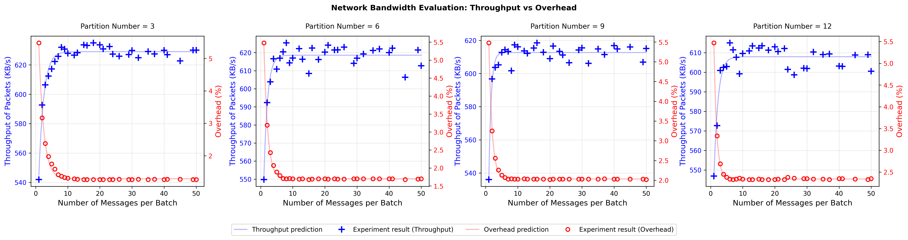
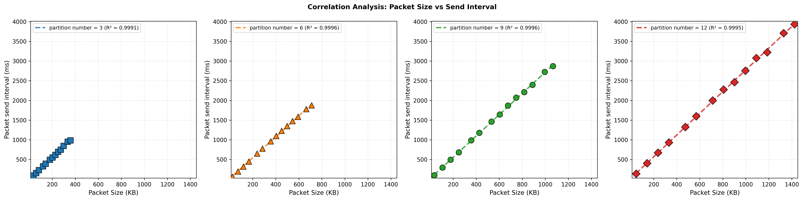

# Kafka Performance Analysis

[](https://www.docker.com/)
[](https://www.python.org/)
[](https://kafka.apache.org/)

## 📖 Panoramica

Questo progetto implementa un ambiente Kafka distribuito per l'analisi delle performance in condizioni di rete controllate. Prevede:
- **3 broker Kafka** in modalità KRaft
- **2 producer** che generano messaggi
- **3 consumer** suddivisi in 2 gruppi
- **Network Emulator** per simulare delay
- **Message Generator** per la creazione controllata di messaggi

Ognuno di questi componenti è stato implementato come servizio Docker indipendente.

## 🏗️ Architettura

### Componenti principali

#### Kafka brokers (3 istanze)

- Modalità KRaft 
- Porte: 9092, 9093, 9094 (host), 29092 (inter-broker)
- Porte JMX: 9999, 10000, 10001 per metriche
- Rete: `net_brokers` (172.20.10.0/24)
- Replication Factor: 3 (hardcoded)
- Min ISR: 2 (numero minimo di repliche “in-sync”)

#### Producers (2 istanze)

- Recuperano messaggi dal *Message Generator* tramite una chiamata API GET
- Inoltrano verso Kafka con batching configurabile
- Invio su un singolo topic per esperimento (non multi-topic)
- Scrivono file `data/stats/*_stats.json` con:
  - metriche utili alla sperimentazione
  - overhead e throughput misurati dai broker via JMX
- Rete: `net_producers` (172.20.20.0/24) + `net_msggen`

#### Consumers (3 istanze)

- 2 consumer in `group_1`, 1 consumer in `group_2`
- Tracciano timestamp di ricezione per la latency analysis
- Salvano il recap dei messaggi processati
- Reti: `net_consumers_g1` (172.20.30.0/24), `net_consumers_g2` (172.20.40.0/24)

#### Message Generator

- Servizio FastAPI con endpoint `/next-message`
- Genera payload con chiave incrementale e metadata temporali
- Rete: `net_msggen` (172.20.50.0/24)

#### Network Emulator

- Router centrale collegato a tutte le subnet
- Applica regole `tc/netem` per simulare delay

#### Kafka UI

- Interfaccia web per monitorare il cluster su porta 8080


## 📁 Struttura del Progetto

```
.
├── broker/                          # Configurazione broker Kafka
│   ├── Dockerfile
│   └── configure_routing.sh
├── producer/                        # Producer Kafka
│   ├── Dockerfile
│   ├── producer.py
│   ├── configure_routing.sh
│   └── requirements.txt
├── consumer/                        # Consumer Kafka
│   ├── Dockerfile
│   ├── consumer.py
│   ├── configure_routing.sh
│   └── requirements.txt
├── message_generator/               # Generatore API REST di messaggi
│   ├── Dockerfile
│   ├── message_generator.py
│   └── requirements.txt
├── network_emulator/                # Emulatore condizioni di rete e funge da router centrale
│   ├── Dockerfile
│   ├── configure_routing.sh
│   └── network_rules.conf
├── experiments/
│   ├── latency_analysis/
│   |   ├── reports/
│   |   |   └── latency_report.json       # Output dell'esprimento
│   │   └── latency_analysis.py
│   ├── correlation_analysis/
│   |   ├── plots/
│   |   |   └── correlation_analysis.png      # Output dell'esprimento
│   |   ├── correlation_analysis_launch.sh 
│   |   └── plot_correlation_analysis.py  
│   └── network_bandwidth_evaluation/
│       ├── plots/
│       |   └── network_bandwidth_evaluation.png      # Output dell'esprimento
│       ├── network_bandwidth_evaluation_launch.sh 
│       └── plot_network_bandwidth_evaluation.py 
├── scripts/
|   └── modules/                      # Moduli di supporto
│     ├── docker_build.sh         
│     ├── docker_deploy.sh       
│     ├── experiment_config.sh        
│     ├── experiment_timer.sh        
│     └── network_config.sh      
|   ├── custom_setup_environment.sh  # Avvio dell'ambiente 
│   ├── teardown_environment.sh      # Cleanup
│   └── update_stats_with_jmx.py     # Raccoglie le metriche con JMX
├── data/                            # Output (messaggi, recap e statistiche)
|   └── stats/ 
├── docker-compose.yml               # Orchestrazione servizi
├── .gitignore
├── README.md                        # Documentazione
└── requirements.txt                 # Pacchetti necessari alla preparazione dell'ambiente python
```

## 🚀 Quick Start

### Prerequisiti

Prima di iniziare, assicurati di avere installato:

- **Docker** e **Docker Compose**
- **Python** 
- **Git** (per clonare il repository)

### Preparazione Ambiente Python

```bash
# Crea virtual environment
python -m venv venv

# Attiva ambiente virtuale
# Linux/Mac:
source venv/bin/activate
# Windows (Git Bash):
source venv/Scripts/activate

# Installa dipendenze
pip install -r requirements.txt

# Crea directory di output
mkdir -p data/stats
```

## 🧪 Esperimenti

### 1. Esperimento Singolo

```bash
./scripts/custom_setup_environment.sh
```

Parametri richiesti:
1. **Modalità esperimento:**
  - Time-based (durata fissa in second) 
  - Message-based (target numero messaggi)
2. **Network Emulation:**
  - Delay/jitter per ogni subnet
3. **Topic:**
  - Numero di partizioni (3, 6, 9, 12)
  - Payload Size: dimensione messaggi in bytes
  - Batch Size: messaggi per batch
  - Duration/Target: secondi o numero messaggi

Questo script:
- Configura le regole di emulazione di rete (delay, packet loss)
- Imposta la durata dell'esperimento o il target dei messaggi da generare 
- Regola payload size, numero di messaggi per batch, ecc.
- Effettua il build delle immagini Docker
- Avvia tutti i servizi

Durante l'esecuzione:
- **Minuti 0-1:** Fase di inizializzazione dei servizi
- **Minuti 1+:** Produzione e consumo di messaggi
- **Fine:** Raccolta metriche JMX e generazione file stats

Al termine dell'esperimento saranno disponibili nella folder `data` il recap dei messaggi generati, e nella folder `data\stats` le statistiche varie, tra cui throughput, overhead e altre metriche utili. 

--- 

### 2. Analisi Latency
**Obiettivo:** analizzare la latenza end-to-end (producer → broker → consumer).
```bash
# 1. Esegui esperimento singolo
./scripts/custom_setup_environment.sh

# 2. Genera report latenza
python ./experiments/latency_analysis/latency_analysis.py
```

**Metriche calcolate:**
**Latency** = `receive_timestamp_ms - producer_send_timestamp_ms`


**Output:** `reports/latency_report.json`

---

### 3. Network Bandwidth Evaluation
**Obiettivo:** valutare throughput e overhead al variare di batch size e numero partizioni.
```bash
# Esegue 120 esperimenti (4 partizioni × 30 batch sizes)
./experiments/network_bandwidth_evaluation/network_bandwidth_evaluation_launch.sh

# Genera plot
python ./experiments/network_bandwidth_evaluation/plot_network_bandwidth_evaluation.py
```
**Configurazione:**
  - Partition counts: 3, 6, 9, 12
  - Batch sizes: 1, 2, 3, 4, 5, 6, 7, 8, 9, 10, 12, 13, 15, 16, 18, 20, 21, 23, 24, 26, 29, 30, 32, 35, 37, 40, 41, 45, 49, 50
  - Payload size: 1000 bytes
  - Target messages: 50K

**Metriche calcolate:**
  1. Kafka Total Bytes (JMX):
  **kafka_total_bytes** = `BytesInPerSec`
  2. Kafka Overhead:
  **kafka_overhead_bytes** = `kafka_total_bytes - payload_bytes`
  3. Overhead Percentage:
  **overhead_%** = `(kafka_overhead_bytes / kafka_total_bytes) * 100`
  4. Throughput:
  **throughput_kbps** = `(kafka_total_bytes / 1024) / transmission_time_seconds`

**Modelli di fitting:**
  - Throughput (saturazione esponenziale):
  **T(x)** = `c - a · e^(-b x)`
  - Overhead (decadimento esponenziale):
  **O(x)** = `a · e^(-b x) + c`

**Output:**
Il plot mostra 4 subplot (uno per configurazione di partizioni) con:
  - Asse Y sinistro (blu): Throughput (KB/s) con prediction curve
  - Asse Y destro (rosso): Overhead (%) con prediction curve
  - Marker blu (+): Risultati sperimentali throughput
  - Marker rosso (○): Risultati sperimentali overhead

---

### 4. Correlation Analysis
**Obiettivo:** analizzare la correlazione tra dimensione pacchetto (Sr) e intervallo di invio (Gs).
```bash
# Esegue 48 esperimenti (4 partizioni × 12 batch sizes)
./experiments/correlation_analysis/correlation_analysis_launch.sh

# Genera plot
python ./experiments/correlation_analysis/plot_correlation_analysis.py
```

**Configurazione:**
- Partition counts: 3, 6, 9, 12
- Batch sizes: 10, 30, 50, 70, 90, 110, 130, 150, 170, 190, 200, 250
- Payload size: 1000 bytes
- Durata: 20s produzione + 30s warmup

**Formule:**

1. **Serialized Message Size (Sm):**
   
   **Sm** = `len(key_bytes) + len(value_bytes)`

2. **Serialized Batch Size (Sb):**
   
   **Sb** = `(Sm * Nb + batch_header_size) / compression_ratio`

   **Dove:**
   - `Nb` = numero messaggi per batch  
   - `batch_header_size` = 61 bytes (Kafka protocol)  
   - `compression_ratio` = 1.0 (no compression)

3. **Group Send Interval (Gs):**
   
   **Gs** = `timestamp_current_group - timestamp_previous_group`

   Un *gruppo* consiste di \( P \) batch consecutivi (dove \( P \) = partizioni per broker).

4. **Request Size (Sr):**
   
   **Sr** = `Sb * P + packet_header_size`

   **Dove:**
   - `P` = numero di partizioni gestite da un broker  
   - `packet_header_size` = overhead TCP/IP + Kafka protocol

5. **Packet Header Size:**
   
   **packet_header_size** = `(kafka_total_bytes - sum(Sb * num_batches)) / total_batches`

   Dove `kafka_total_bytes` è raccolto via JMX (`BytesInPerSec`).


**Filtro Dati:**
Le metriche vengono filtrate utilizzando i percentili **P5–P95** su `Gs` per rimuovere outlier.

**Output:**
Il plot mostra 4 subplot (uno per configurazione di partizioni) con:
  - Asse Y: Packet Send Interval (ms)
  - Asse X: Packet Size (KB)  
  - Fit lineare: 
    **Gs** = `a * Sr + b`
  - R² score per valutare la correlazione


## 📊 Metriche e Output

### File di Output

- **`data/producer_*_messages.jsonl`**: Record di invio messaggi
  ```json
  {
    "key": "8", 
    "run_id": "test_3_partitions_NB_50_PS_200", 
    "topic": "test_3_partitions", 
    "partition": 2,
    "broker_id": 1,
    "message": ".........", 
    "message_size_bytes": 411, 
    "send_timestamp_ms": 1768665395468.925, 
    "write_timestamp_ms": 1768665395623.809, 
    "status": "OK", 
    "send_batch_id": 1
  }
  ```

  | Campo                | Descrizione                                                   |
  |----------------------|---------------------------------------------------------------|
  | `key`                | Chiave univoca del messaggio                                  |
  | `run_id`             | Identificatore univoco esperimento						     |
  | `topic`              | Topic Kafka su cui sono stati inviati i messaggi              |
  | `partition`          | Partizione Kafka di destinazione                              |
  | `broker_id`          | ID del broker leader della partizione                         |
  | `message`            | Payload effettivo del messaggio             					 |
  | `message_size_bytes` | Dimensione totale (key + value serializzati)                  |
  | `send_timestamp_ms`  | Timestamp di creazione del messaggio nel producer             |
  | `write_timestamp_ms` | Timestamp del callback di delivery (ack dal broker)           |
  | `status`             | Stato della delivery del messaggio             				 |
  | `send_batch_id`      | ID del batch di appartenenza                                  |

- **`data/consumer_*_messages.jsonl`**: Record di ricezione messaggi
  ```json
  {
    "key": "1", 
    "run_id": "test_3_partitions_NB_50_PS_200", 
    "topic": "test_3_partitions", 
    "partition": 2, 
    "offset": 0, 
    "message": "..........", 
    "receive_timestamp_ms": 1768665395603.1628, 
    "producer_send_timestamp_ms": 1768665395455.4229
  }
  ```

  | Campo                      | Descrizione                                        					|
  | -------------------------- | ---------------------------------------------------------------------- |
  | `key`                        | Chiave univoca del messaggio Kafka                 					|
  | `run_id`                     | Identificatore univoco esperimento                 					|
  | `topic`                      | Topic Kafka su cui sono stati inviati i messaggi    					|
  | `partition`                  | ID della partizione Kafka da cui il consumer ha letto il messaggio     |
  | `offset`                     | Offset del messaggio nella partizione              					|
  | `message`                    | Payload effettivo del messaggio             							|
  | `receive_timestamp_ms`       | Timestamp ricezione nel consumer                  					    |
  | `producer_send_timestamp_ms` | Timestamp invio dal producer (per calcolo latenza) 					|

- **`data/stats/producer_*_stats.json`**: Statistiche del producer
  ```json
  {
    "run_id": "test_3_partitions_NB_10_PS_200",
    "producer_name": "producer_1",
    "topic": "test_3_partitions",
    
    "transmission_stats": {
      "num_messages": 5290,
      "num_batches": 529,
      "payload_bytes": 2218758,
      "transmission_time_seconds": 20.01
    },
    
    "kafka_metrics": {
      "kafka_overhead_bytes": 173690,
      "kafka_total_bytes": 4602647,
      "throughput_kbps": 224.51,
      "overhead_percentage": 3.77,
      "packet_header_size_bytes": 103.07
    },
    
    "experiment_config": {
      "partition_count": 3,
      "nb_messages_per_batch": 10,
      "batch_header_size_bytes": 61,
      "compression_ratio": 1.0,
      "partition_to_broker": {
        "0": 2,
        "1": 3,
        "2": 1
      }
    },
    
    "broker_tracking_summary": {
      "1": {
        "batch_count": 523,
        "partition_count": 1
      },
      "2": {
        "batch_count": 516,
        "partition_count": 1
      },
      "3": {
        "batch_count": 524,
        "partition_count": 1
      }
    },
    
    "batch_metrics": {
      "Nb": 10,
      "P": 1,
      "Sm_mean_bytes": 419.48,
      "Sb_mean_bytes": 4255.76,
      "Gs_mean_ms": 33.36,
      "Sr_mean_bytes": 4358.83
    }
  }
  ```
  | Sezione                 | Campo                     | Descrizione                                                									|
  | ----------------------- | ------------------------- | ----------------------------------------------------------------------------------------------|
  | `Root`                    | `run_id`                    | Identificatore univoco esperimento                                                            |
  |                         | `producer_name`             | Nome container producer che ha generato i dati                                                |
  |                         | `topic`                     | Topic Kafka su cui sono stati inviati i messaggi                                              |
  | `transmission_stats`      | `num_messages`              | Numero totale messaggi inviati dal producer                                                   |
  |                         | `num_batches`               | Numero totale di batch inviati                                                                |
  |                         | `payload_bytes`             | Dimensione totale dei SOLI payload (contenuto utile dei messaggi, senza header Kafka/TCP/IP)  |
  |                         | `transmission_time_seconds` | Tempo effettivo di trasmissione (dal primo al ultimo messaggio)                               |
  | `kafka_metrics`           | `kafka_total_bytes`         | Byte totali ricevuti dai broker (payload + overhead Kafka + header TCP/IP)                    |
  |                         | `kafka_overhead_bytes`      | Overhead totale (header Kafka + TCP/IP + metadati)                                            |
  |                         | `throughput_kbps`           | Throughput effettivo misurato dai broker                                                      |
  |                         | `overhead_percentage`       | Percentuale overhead sul totale                            									|
  |                         | `packet_header_size_bytes`  | Dimensione media header di rete per pacchetto (TCP/IP + Kafka protocol overhead)              |
  | `experiment_config`       | `partition_count`           | Numero partizioni del topic                                									|
  |                         | `nb_messages_per_batch`     | Numero di messaggi per batch (configurato nel producer)                        				|
  |                         | `batch_header_size_bytes`   | Dimensione fissa dell'header del batch Kafka                           						|
  |                         | `compression_ratio`         | Rapporto compressione (1.0 = no compression)               									|
  |                         | `partition_to_broker`       | Mapping partizione → broker leader                         									|
  | `broker_tracking_summary` | `batch_count`               | Numero batch ricevuti dal broker                           									|
  |                         | `partition_count`           | Numero partizioni gestite dal broker                       									|
  | `batch_metrics`           | `Nb`                        | Numero messaggi per batch                                  									|
  |                         | `P`                         | Numero partizioni leader per broker                               							|
  |                         | `Sm_mean_bytes`             | Dimensione media messaggio serializzato (key + value JSON)  									|
  |                         | `Sb_mean_bytes`             | Dimensione media batch serializzato      														|
  |                         | `Gs_mean_ms`                | Intervallo medio tra invii di gruppi completi di batch (ogni P batch)     					|
  |                         | `Sr_mean_bytes`             | Dimensione media pacchetto di rete (batch + header TCP/IP)        							|

- **`experiments/latency_analysis/reports/latency_report.json`**: Latency Report
  ```json
  {
    "run_id": "test_3_partitions_NB_50_PS_200",
    "by_consumer": [
      {
        "consumer": "consumer_1_g1",
        "latency_min_ms": 2.593994140625,
        "latency_max_ms": 184.5341796875,
        "latency_mean_ms": 58.01090192773885,
        "message_count": 41038
      },
      {
        "consumer": "consumer_1_g2",
        "latency_min_ms": 2.374267578125,
        "latency_max_ms": 183.764404296875,
        "latency_mean_ms": 58.00994950736968,
        "message_count": 61750
      },
      {
        "consumer": "consumer_2_g1",
        "latency_min_ms": 2.220703125,
        "latency_max_ms": 147.739990234375,
        "latency_mean_ms": 57.999966842044316,
        "message_count": 20712
      }
    ],
    "by_group": [
      {
        "consumer_group": "group_1",
        "latency_min_ms": 2.220703125,
        "latency_max_ms": 184.5341796875,
        "latency_mean_ms": 58.007234114056175,
        "message_count": 61750
      },
      {
        "consumer_group": "group_2",
        "latency_min_ms": 2.374267578125,
        "latency_max_ms": 183.764404296875,
        "latency_mean_ms": 58.00994950736968,
        "message_count": 61750
      }
    ]
  }
  ```

- **`experiments/network_bandwidth_evaluation/plots/network_bandwidth_evaluation.png`**: 

  

- **`experiments/correlation_analysis/plots/correlation_analysis.png`**: 

  


## 🐳 Docker Compose

Il file `docker-compose.yml` orchestra:

- **3 Broker Kafka** con KRaft 
- **Kafka UI** (port 8080) per visualizzazione cluster
- **2 Producer** su rete dedicata
- **3 Consumer** su 2 reti distinte (per test emulazione separata)
- **Message Generator** (port 8000) su rete dedicata
- **Network Emulator** su tutte le reti

## ⚙️ Variabili d'Ambiente

| Variabile | Descrizione 
|-----------|-------------
| `EXPERIMENT_DURATION` | Durata esperimento (secondi) 
| `TARGET_MESSAGES` | Numero di messaggi da generare 
| `TOPIC_NAME` | Topic Kafka 
| `RUN_ID` | ID della run per tracciamento 
| `PAYLOAD_SIZE_BYTES` | Dimensione payload messaggi 
| `NB_MESSAGES_PER_BATCH` | Messaggi per batch
| `PARTITION_COUNT` | Numero di partizioni 
| `BOOTSTRAP_SERVERS` | Server Kafka bootstrap 

## 🧹 Cleanup

```bash
bash scripts/teardown_environment.sh
```

Ferma i container e pulisce i file (con prompt interattivo).

## 📌 Note Importanti
1. **Replication Factor:** Hardcoded a 3 in tutti i topic
2. **Single Topic:** I producer scrivono su un solo topic per esperimento (no multi-topic simultaneo)
3. **JMX Requirement:** `update_stats_with_jmx.py` richiede broker attivi per raccogliere metriche

## 🔚 Conclusioni
Gli esperimenti condotti sui tre scenari (latency analysis, correlation analysis e network bandwidth evaluation) permettono di evidenziare alcuni comportamenti strutturali del sistema Kafka in presenza di batching e partizionamento.

### Correlation Analysis: relazione tra dimensione pacchetto e tempi di invio

Nel grafico **correlation analysis** si osserva che, a parità di configurazione, l'intervallo medio di invio dei gruppi di batch **(Gs)** cresce all'aumentare della dimensione media del pacchetto serializzato **(Sr)**. Questo comportamento è atteso: pacchetti più grandi richiedono più tempo per essere inviati sulla rete e processati dallo stack TCP/IP e dal broker, quindi l'intervallo tra due "gruppi" di invio tende ad allungarsi.

Tuttavia, l'aumento del tempo non è proporzionale (non raddoppia esattamente raddoppiando la dimensione del pacchetto), ma segue bene una **regressione quasi lineare** del tipo:

**Gs** ≈ `a * Sr + b`

dove:
- Il termine costante **(b)** rappresenta il **costo fisso per richiesta** (overhead di protocollo, scheduling, ecc.)
- Il coefficiente **(a)** è legato principalmente alla **banda disponibile** e alla **latenza della rete**

In altre parole, esiste un costo minimo "per richiesta" che si paga indipendentemente dalla dimensione del batch, e un costo variabile che cresce con i byte effettivamente trasmessi.

#### Effetto del numero di partizioni su Gs

Confrontando le diverse configurazioni di partizioni, si nota che **l'intervallo di invio Gs aumenta con il numero di partizioni**. Questo comportamento è coerente con l'architettura interna del producer Kafka:

- **Più partizioni** → **più code interne** nel producer (una per partizione)
- Maggiore **concorrenza** tra thread di invio
- Aumento dell'**overhead di coordinamento** (lock, sincronizzazione, ...)
- Più richieste HTTP/TCP da gestire simultaneamente verso i broker

Il producer deve coordinare l'invio verso un numero maggiore di partizioni distribuite sui broker, con conseguente incremento del tempo necessario per completare un ciclo di invio completo. 
Il risultato netto è che il tempo medio di invio per singolo gruppo cresce con il numero di partizioni, pur beneficiando della parallelizzazione lato broker. Le rette di regressione lineare stimate mostrano infatti **pendenze e intercette diverse** per ciascuna configurazione di partizioni, confermando questo effetto sistemico.

---

### Network Bandwidth Evaluation: throughput e overhead al variare del batch size

Nel grafico **network bandwidth evaluation**, fissato un numero di partizioni, il **throughput** cresce all'aumentare del batch size, ma non in modo **lineare**: i primi incrementi di batch size portano un guadagno molto marcato, mentre oltre una certa soglia l'incremento di throughput tende a saturare.

Il throughput cresce secondo un modello di **saturazione esponenziale**:

**T(x)** = `c - a * e^(-b x)`

dove:
- **x** è il batch size **(Nb)**
- **c** rappresenta il **throughput massimo teorico**
- **a** e **b** caratterizzano la velocità di saturazione

**Fase iniziale (batch piccoli):**  
Il termine esponenziale `e^(-b x)` è grande → throughput basso.

**Fase di saturazione (batch grandi):**  
Il termine esponenziale tende a 0 → throughput si avvicina a **c**.

#### Andamento dell'overhead relativo

Per quanto riguarda l'**overhead percentuale**, la curva mostra un **decadimento esponenziale**:

**O(x)** = `a * e^(-b x) + c`

La **stabilizzazione** dell'overhead a valori bassi riflette il fatto che, aumentando ulteriormente il batch size, la struttura del protocollo Kafka non cambia.

### Effetto del numero di partizioni

Variando il numero di partizioni si osservano **shifting e differenze di forma** nelle curve di throughput e overhead.

**Più partizioni → Vantaggi:**
- Maggiore parallelismo
- Throughput massimo teorico più elevato
- Migliore distribuzione del carico

**Più partizioni → Svantaggi:**
- Più metadata da gestire
- Più traffico di replica
- Più code interne nel producer
- Overhead di coordinamento crescente

Esiste quindi una **regione ottimale** che bilancia parallelismo e overhead.

## 📚 Riferimenti

### 1. Performance Prediction Model

Wu, H., Shang, Z., & Wolter, K. (2019). *Performance Prediction for the Apache Kafka Messaging System*. In 2019 IEEE 21st International Conference on High Performance Computing and Communications (HPCC), pp. 154-161. IEEE.

**Link:** https://doi.org/10.1109/HPCC/SmartCity/DSS.2019.00036

### 2. Reactive Batching Strategy

Wu, H., Shang, Z., & Wolter, K. (2018). *A Reactive Batching Strategy of Apache Kafka for Reliable Stream Processing in Real-time*. In 2018 IEEE International Symposium on Software Reliability Engineering Workshops (ISSREW), pp. 207-214. IEEE.

**Link:** https://ieeexplore.ieee.org/document/9251089
