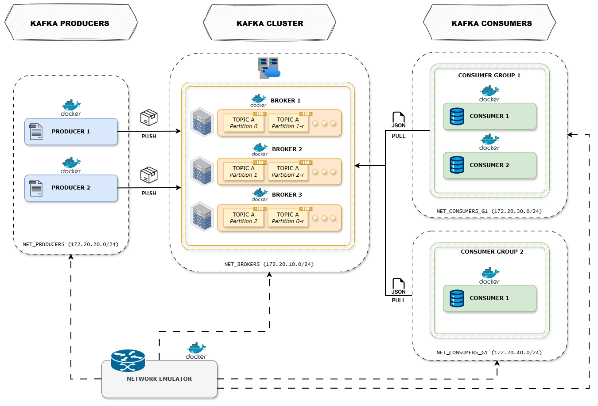
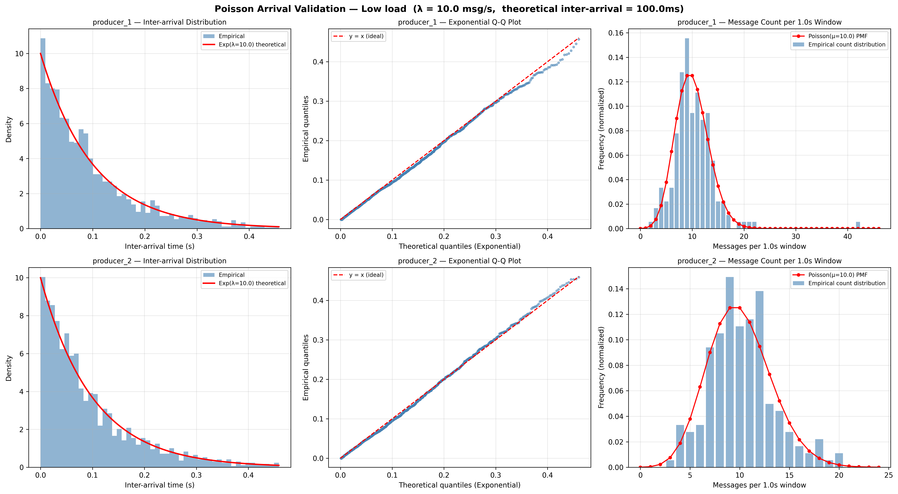
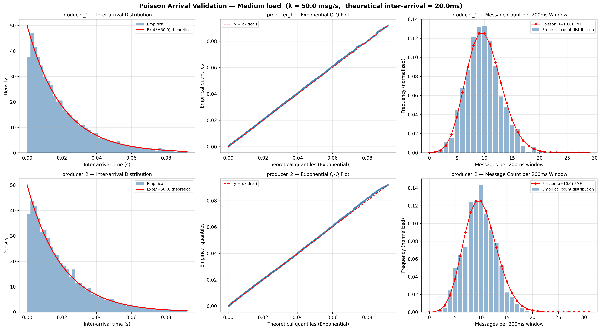
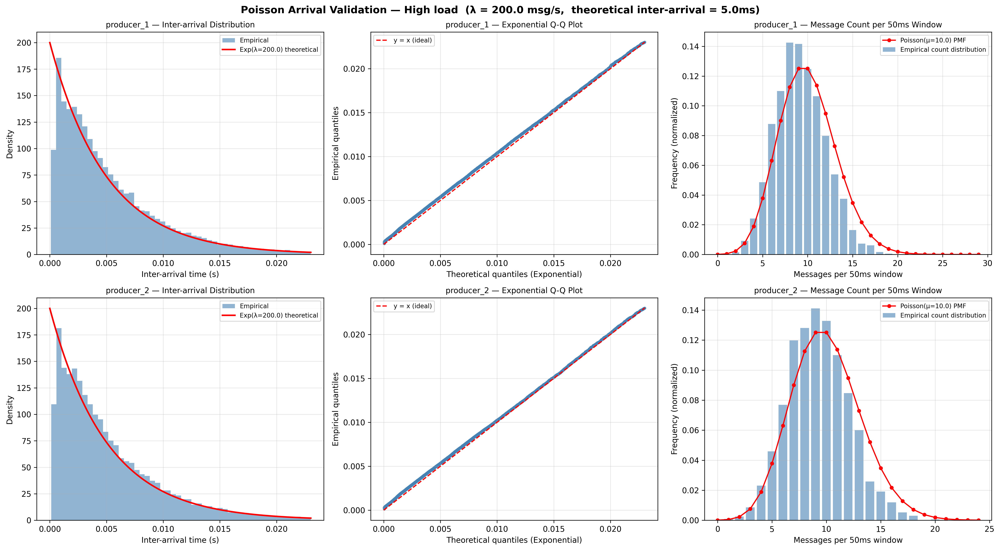
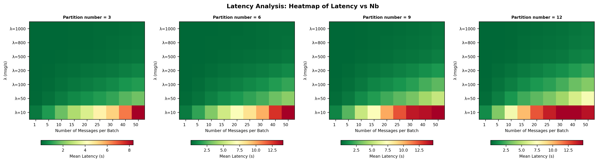
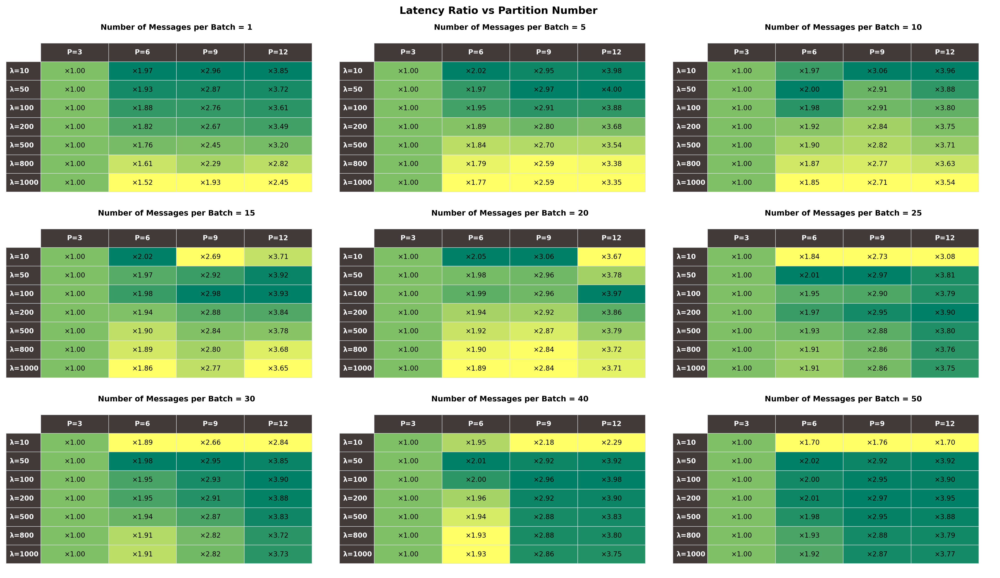
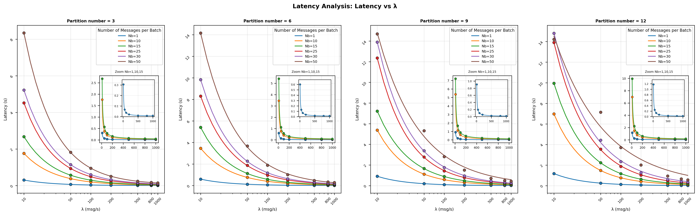
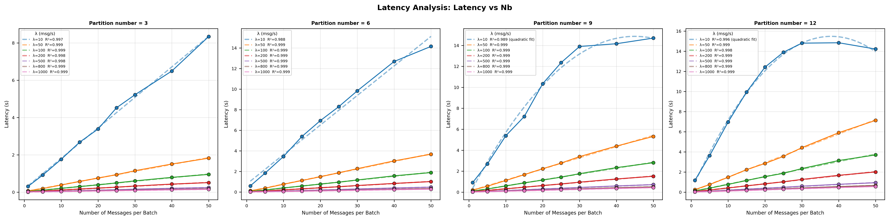
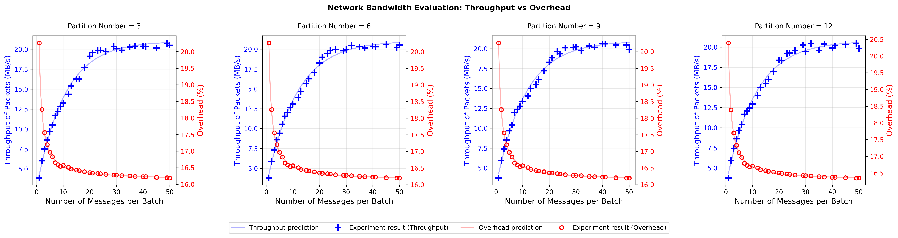
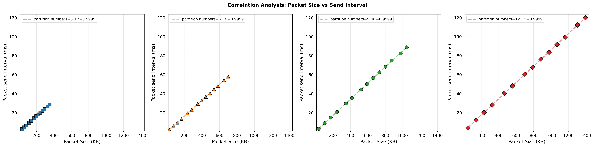

# Kafka Performance Analysis

[](https://www.docker.com/)
[](https://www.python.org/)
[](https://kafka.apache.org/)

## 📖 Panoramica

Questo progetto implementa un ambiente Kafka distribuito per l'analisi delle performance in condizioni di rete controllate. Prevede:
- **3 broker Kafka** in modalità KRaft
- **2 producer** che generano messaggi
- **3 consumer** suddivisi in 2 gruppi
- **Network Emulator** per simulare condizioni di rete controllate (delay/jitter con distribuzione variabile, packet loss, packet duplication)

Ognuno di questi componenti è stato implementato come servizio Docker indipendente.

## 🏗️ Architettura



### Componenti principali

#### Kafka brokers (3 istanze)

- Modalità KRaft 
- Porte: 9092, 9093, 9094 (host), 29092 (inter-broker)
- Porte JMX: 9999, 10000, 10001 per metriche
- Rete: `net_brokers` (172.20.10.0/24)
- Replication Factor: 3 (hardcoded)
- Min ISR: 2 (numero minimo di repliche “in-sync”)

#### Producers (2 istanze)

- Generano messaggi in due modalità: Poisson / Continuous
- Inoltrano verso Kafka con batching configurabile
- Invio su un singolo topic per esperimento (non multi-topic)
- Scrivono file `data/stats/*_stats.json` con:
  - metriche utili alla sperimentazione
  - overhead e throughput misurati dai broker via JMX
- Salvano il recap dei messaggi generati e inoltrati in `data/producer_*_messages_recap.jsonl`
- Rete: `net_producers` (172.20.20.0/24)

#### Consumers (3 istanze)

- 2 consumer in `group_1`, 1 consumer in `group_2`
- Tracciano timestamp di ricezione per la latency analysis
- Salvano il recap dei messaggi processati in `data/consumer_*_messages_recap.jsonl`
- Reti: `net_consumers_g1` (172.20.30.0/24), `net_consumers_g2` (172.20.40.0/24)

#### Network Emulator

- Router centrale collegato a tutte le subnet
- Applica regole `tc/netem` per simulare delay con distribuzione variabile, packet duplication e packet loss

#### Kafka UI

- Interfaccia web per monitorare il cluster su porta 8080


## 📁 Struttura del Progetto

```
.
├── broker/                          
│   ├── Dockerfile
│   └── configure_routing.sh
├── producer/                       
│   ├── Dockerfile
│   ├── producer.py
│   ├── configure_routing.sh
│   └── requirements.txt
├── consumer/                        
│   ├── Dockerfile
│   ├── consumer.py
│   ├── configure_routing.sh
│   └── requirements.txt
├── network_emulator/                
│   ├── Dockerfile
│   ├── configure_routing.sh
│   └── network_rules.conf
├── experiments/
│   ├── latency_analysis/
│   |   ├── plots/                        
│   |   |   |── latency_boxplot_of_latency_vs_nb.png  
│   |   |   |── latency_heatmap_of_latency_vs_nb.png  
│   |   |   |── latency_ratio_vs_partition_number.png  
│   |   |   |── latency_vs_lambda.png 
│   |   |   └── latency_vs_nb.png  
│   |   ├── reports/      
│   │   |── generate_report_latency.py
│   │   |── latency_analysis_launch.sh
│   │   └── plot_latency_analysis.py
│   ├── correlation_analysis/
│   |   ├── plots/
│   |   |   └── correlation_analysis.png      
│   |   ├── correlation_analysis_launch.sh 
│   |   └── plot_correlation_analysis.py  
│   ├── poisson_validation/
│   |   ├── plots/
│   |   |   |── poisson_validation_lambda_rate_10.png    
│   |   |   |── poisson_validation_lambda_rate_50.png
│   |   |   └── poisson_validation_lambda_rate_200.png    
│   |   └── plot_poisson_validation.py 
│   └── network_bandwidth_evaluation/
│       ├── plots/
│       |   └── network_bandwidth_evaluation.png     
│       ├── network_bandwidth_evaluation_launch.sh 
│       └── plot_network_bandwidth_evaluation.py 
├── scripts/
|   |── modules/                      
│   | ├── docker_build.sh         
│   | ├── docker_deploy.sh       
│   | ├── experiment_config.sh        
│   | ├── experiment_timer.sh        
│   | └── network_config.sh      
|   ├── custom_setup_environment.sh  
│   ├── teardown_environment.sh     
│   └── update_stats_with_jmx.py     
├── utilities/
|   ├── __init__.py  
│   ├── confidence_interval.py     
│   └── tukey_iqr.py    
├── data/                            
|   └── stats/ 
├── docs/ 
├── docker-compose.yml               
├── .gitignore
├── README.md                        
└── requirements.txt                 
```

## 🛠️ Utilities

La cartella `utilities/` contiene moduli Python riutilizzati da tutti gli script di sperimentazione per il filtraggio degli outlier e la stima statistica multi-run.

### `tukey_iqr.py` — Filtro outlier IQR Tukey
Rimuove gli outlier da un array di valori usando il metodo di Tukey basato
sull'Interquartile Range (IQR). Il criterio di esclusione è:
$$\text{lower} = Q_1 - 1.5 \cdot IQR \qquad \text{upper} = Q_3 + 1.5 \cdot IQR$$
Tutti i valori che cadono fuori dall'intervallo `[lower, upper]` vengono considerati outlier e scartati. Questo filtro viene applicato tra run diversi della stessa configurazione.

### `confidence_interval.py` — Intervallo di Confidenza al 95%
Calcola la stima puntuale e l'intervallo di confidenza al 95% sui run filtrati dall'IQR, usando la t-distribution di Student:
$$CI = \bar{x} \pm t^*_{n-1} \cdot \frac{s}{\sqrt{n}}$$
dove:
- $\bar{x}$ è la media campionaria
- $s$ è la deviazione standard campionaria
- $n$ è il numero di run validi dopo il filtro IQR
- $t^*_{n-1}$ è il valore critico della t-distribution con $n-1$ gradi di libertà

Il valore rappresentativo usato nei plot è il punto centrale dell'intervallo:
$$\text{representative\_point} = \frac{CI_{\text{lower}} + CI_{\text{upper}}}{2}$$

Si usa la **t-distribution di Student** anziché il test z perché il numero di campioni disponibili è ridotto (5 run per la latency analysis, 10 per gli altri
esperimenti). Con campioni piccoli, la t-distribution produce intervalli più conservativi e quindi stime più accurate dell'incertezza reale, compensando la sottostima della deviazione standard campionaria tipica di $n$ piccoli.


## 🚀 Quick Start

### Prerequisiti

Prima di iniziare, assicurati di avere installato:

- **Docker** e **Docker Compose**
- **Python** 
- **Git** (per clonare il repository)

### Preparazione Ambiente Python

```bash
# Crea virtual environment
python -m venv venv

# Attiva ambiente virtuale
# Linux/Mac:
source venv/bin/activate
# Windows (Git Bash):
source venv/Scripts/activate

# Installa dipendenze
pip install -r requirements.txt

# Crea directory di output
mkdir -p data/stats
```

## 🧪 Esperimenti

### 1. Esperimento Singolo

```bash
./scripts/custom_setup_environment.sh
```

Parametri richiesti:
1. **Modalità esperimento:**
  - Time-based (durata fissa in second) 
  - Message-based (target numero messaggi)
2. **Network Emulation:**
  - Delay/jitter con distribuzione variabile (uniform | normal | pareto | paretonormal), packet loss e packet duplication per ogni subnet
3. **Topic:**
  - Numero di partizioni (3, 6, 9, 12)
  - Payload Size: dimensione messaggi in bytes
  - Batch Size: messaggi per batch
  - Duration/Target: secondi o numero messaggi
4. **Modalità generazione messaggi:**
   - **Poisson** (`SEND_MODE=poisson`) — Rate-limited Poisson arrivals
      - `LOW`  — λ=10 msg/s  → inter-arrival teorico ≈ 100ms
      - `MEDIUM` — λ=50 msg/s  → inter-arrival teorico ≈ 20ms
      - `HIGH` — λ=200 msg/s → inter-arrival teorico ≈ 5ms
   - **Continuous** (`SEND_MODE=continuous`) — Heavy load, no rate limiting


Questo script:
- Configura le regole di emulazione di rete (delay, packet loss e duplication)
- Imposta la durata dell'esperimento o il target dei messaggi da generare 
- Regola payload size, numero di messaggi per batch, ecc.
- Imposta la modaità con la quale verranno generati i messaggi dai producer
- Effettua il build delle immagini Docker
- Avvia tutti i servizi

Durante l'esecuzione:
- **Minuti 0-1:** Fase di inizializzazione dei servizi
- **Minuti 1+:** Produzione e consumo di messaggi
- **Fine:** Raccolta metriche JMX e generazione file stats

Al termine dell'esperimento saranno disponibili nella folder `data` il recap dei messaggi generati, e nella folder `data\stats` le statistiche varie, tra cui throughput, overhead e altre metriche utili. 

---

### 2. Poisson Process Validation
**Obiettivo:** verificare che la modalità `SEND_MODE=poisson` produca effettivamente un flusso di messaggi con tempi di inter-arrivo distribuiti secondo un processo di Poisson. 

Questo modello rappresenta correttamente sistemi reali in cui i messaggi arrivano in modo **stocastico e indipendente**, al contrario della modalità `continuous` che genera un flusso artificialmente continuo a massimo throughput.

```bash
# Genera dati (va scelta la modalità Poisson)
./scripts/custom_setup_environment.sh

# Genera i plot di validazione
python ./experiments/poisson_validation/plot_poisson_validation.py
```

**Filtraggio degli outlier:** 
Prima di generare i plot, gli inter-arrival times vengono filtrati per rimuovere eventi anomali. Il criterio di filtraggio è basato sulla distribuzione esponenziale teorica:
Dato un livello di significatività `α = 0.01`, viene calcolata la soglia:
$$x_{thr} = \frac{-\ln(\alpha)}{\lambda}$$
che rappresenta il valore oltre il quale la probabilità di osservare un inter-arrival time è inferiore all'1% secondo il modello esponenziale teorico. Tutti gli inter-arrival times superiori a `x_thr` vengono scartati come outlier.

**Plot generati:** 
I tre subplot testano proprietà **distinte e complementari** del processo di Poisson.
  1. `Inter-arrival Distribution`: mostra la distribuzione dei tempi tra messaggi consecutivi sovrapposta alla Funzione di Densità di Probabilità teorica esponenziale $$f(t) = \lambda \cdot e^{-\lambda t}$$. Se il processo è correttamente Poisson, le barre dell'istogramma devono allinearsi alla curva teorica. Questo conferma che i messaggi vengono generati con inter-arrival times esponenzialmente distribuiti. Gli inter-arrival times sono calcolati come differenze consecutive del campo `send_timestamp_ms` dei file `producer_*_messages_recap.jsonl`.

  2. `Exponential Q-Q Plot`: il Q-Q plot confronta i quantili empirici degli inter-arrival times con i quantili teorici della distribuzione esponenziale. Se i punti si allineano sulla diagonale y = x (ideal), i dati seguono effettivamente una distribuzione esponenziale. 
  3. `Message Count per Window`: mostra la distribuzione empirica del numero di messaggi ricevuti in finestre temporali di 1 secondo, sovrapposta alla PMF (Probability Mass Function) teorica di Poisson $$P(k) = \frac{\lambda^k \cdot e^{-\lambda}}{k!}$$
  La finestra è scelta in modo che la **media teorica di messaggi per finestra sia sempre pari a 10** (`μ = λ · window = λ · 10/λ = 10`), indipendentemente dal valore di λ. Questo rende i plot confrontabili tra le diverse configurazioni di carico (Low, Medium, High), evitando che la distribuzione si sposti su scale diverse e renda difficile la visualizzazione e la comprensione del plot.
  Questa scelta è statisticamente valida poichè per la proprietà di scala del processo di Poisson, il numero di arrivi in un intervallo $T$ segue $\text{Poisson}(\mu = \lambda T)$. Fissare $T = 10/\lambda$ impone $\mu = 10$ per qualsiasi $\lambda$, preservando la forma della distribuzione e la correttezza del confronto con la PMF teorica.


- **`λ = 10 Low performance`**: 

  

- **`λ = 50 Medium performance`**: 

  

- **`λ = 200 High performance`**: 

  

--- 

### 3. Latency Analysis
**Obiettivo:** analizzare la latenza end-to-end (producer → broker → consumer).
```bash
# 1. Esegue 5 run x 216 esperimenti (4 partizioni x 9 batch sizes x 6 lambda rates) 
./experiments/latency_analysis/latency_analysis_launch.sh

# 2. Genera plots
python ./experiments/latency_analysis/plot_latency_analysis.py
```

> **Nota:** `generate_report_latency.py` viene eseguito automaticamente al termine
> di ogni run dallo script `latency_analysis_launch.sh`. Genera il file
> `experiments/latency_analysis/reports/latency_report.json` con le statistiche
> aggregate per run, che viene poi letto da `plot_latency_analysis.py` per
> produrre i plot finali.


**Configurazione:**
  - Partition counts: 3, 6, 9, 12
  - Batch sizes: 1, 5, 10, 15, 20, 25, 30, 40, 50
  - Lambda rates: 50, 100, 200, 500, 800, 1000
  - Payload size: 200 bytes
  - Numero di run per configurazione: 5
  - Durata: 60s produzione + 30s warmup
  - Modalità di generazione messaggi: Poisson

**Durata media in ore dell'intero esperimento:** ~52 ore

**Metriche calcolate:**
**Latency** = `receive_timestamp_ms - producer_send_timestamp_ms`

La latenza end-to-end può essere decomposta come:
$$L_{e2e} = T_{buffer} + T_{broker} + T_{consumer}$$

dove:
- $T_{buffer}$: tempo di attesa nel buffer del producer fino al riempimento del batch
- $T_{broker}$: tempo di scrittura, replica tra broker e commit sul topic
- $T_{consumer}$: tempo di polling e processing lato consumer

**Aggregazione multi-run:**
Per ogni configurazione (λ, Nb, partizioni), i 5 run vengono aggregati con:
  - Filtro outlier: IQR Tukey sulla latency media di ogni run
  - Stima: per ogni metrica viene calcolato l'intervallo di confidenza al 95% (t-distribution) sui run filtrati; il valore rappresentativo è il punto centrale dell'intervallo $representative\_point = \frac{ci\_{lower} + ci\_{upper}}{2}$

**Plot generati:** 
  1. `latency_vs_nb.png`: Latency (s) vs Nb, curve per λ, con regressione
     adattiva e R²:
     - **Regressione lineare** $L = a \cdot N_b + c$ quando R² ≥ 0.95, che descrive il regime in cui la latenza cresce quasi linearmente con il batch size perché il termine dominante è il tempo di riempimento
       del buffer $T_{buffer}$.
     - **Regressione quadratica** $L = a \cdot N_b^2 + b \cdot N_b + c$ (label: `quadratic fit`) quando R² < 0.95, tipicamente per λ molto bassi e molti topic partitions. In questo caso il sistema entra in un regime di saturazione / accodamento e l’aumento di latenza con Nb diventa super-lineare.
  2. `latency_vs_lambda.png`: Latency (s) vs λ (scala log), curve per Nb, con
     fit **power-hyperbolic**:
     $$L(\lambda) = \frac{a}{\lambda^b} + c$$
     Questo modello generalizza l’iperbole classica $\frac{a}{\lambda} + c$ aggiungendo l’esponente $b$: per Nb piccoli i dati sono compatibili con $b \approx 1$, mentre per Nb grandi le curve diventano più piatte $(b < 1)$ perché,
     oltre una certa soglia di λ, la latenza è dominata da $T_{broker}$ e $T_{consumer}$ e smette di decrescere in modo puramente iperbolico.
     Nel pannello con **P=12** questo effetto è particolarmente visibile: le curve per Nb elevati non sono più perfettamente aderenti al modello power-hyperbolic e mostrano un leggero disallineamento tra punti e prediction. Questo non è un errore di fitting ma la manifestazione grafica del passaggio al regime timeout-dominated indotto da `linger_ms`.

  3. `latency_heatmap_of_latency_vs_nb.png`: Heatmap λ × Nb con sfumatura di colore per latency media
  4. `latency_boxplot_of_latency_vs_nb.png`: Boxplot latency vs Nb, griglia partizioni × λ
  5. `latency_partition_ratio_table.png`: Tabella del rapporto della latency al variare del numero di partizioni, per ogni configurazione (λ, Nb)

  > **R²** (coefficiente di determinazione) misura la proporzione di varianza dei
  > dati spiegata dal modello di regressione. Varia tra 0 e 1: un valore vicino
  > a 1 indica che il modello si adatta bene ai dati; un valore basso indica che
  > la relazione assunta non cattura adeguatamente il comportamento osservato.


  - **`Boxplot of Latency vs Nb`**: 

  

  I boxplot `latency_boxplot_of_latency_vs_nb.png` evidenziano diversi comportamenti strutturali:
  - **Ampiezza del box cresce con Nb:** all'aumentare del batch size la distribuzione di latenza si allarga, segnalando che il batching non solo aumenta la latenza media ma ne incrementa anche la **variabilità**.
  - **Asimmetria positiva:** il whisker superiore è sistematicamente più lungo di quello inferiore; alcuni messaggi sperimentano latenze molto superiori alla mediana, in particolare per Nb elevati.
  - **Box più stretti ad alto λ:** con rate elevati i box sono più compatti, confermando che λ alto riduce sia la latenza media sia la sua dispersione: i batch si riempiono rapidamente e in modo più uniforme.
  - **Comportamento a λ basso e molte partizioni:** nell’ultima riga (λ=10), per Nb elevati i box tendono a diventare simili tra loro a prescindere da Nb e dal numero di partizioni. In questo regime $\frac{\lambda}{P}$ è così basso che il tempo teorico di riempimento del batch supera `linger_ms = 30000 ms`. I batch vengono quindi inviati per timeout, spesso parzialmente pieni, e la latenza osservata è dominata dal valore di `linger_ms`. L’aumento del batch size non produce più variazioni significative nella distribuzione di latenza.

  - **`Heatmap of Latency vs Nb`**: 

    

  - **`Ratio vs Partition`**: 

    

  - **`Latency vs λ`**: 

    

  - **`Latency vs Nb`**: 

    

#### Confronto tra heavy load e Poisson

Nel caso **heavy load** (modalità `continuous` usata negli altri esperimenti), il producer genera messaggi a massimo throughput; il flusso in ingresso è sufficientemente alto da riempire i batch ben prima della scadenza di `linger_ms = 30000 ms`. In questo regime il sistema è **abbastanza performante** da non incontrare il limite imposto da `linger_ms`, e i batch vengono inviati praticamente sempre a capacità massima.

La modalità **Poisson** permette invece di esplorare anche scenari di carico parziale: quando $\lambda$ è abbastanza grande da riempire un batch entro `linger_ms`, la latenza segue i modelli teorici basati su $T_{buffer}$ (fit lineare in funzione di Nb, power-hyperbolic in funzione di λ). Quando invece $\frac{\lambda}{P}$ è così basso da non riuscire a riempire il batch in tempo, si osserva un cambio di regime: i batch vengono inviati anticipatamente per scadenza del timer e la latenza si avvicina a `linger_ms`, diventando poco sensibile alle variazioni di Nb e di P.

---

### 4. Network Bandwidth Evaluation
**Obiettivo:** valutare throughput e overhead al variare di batch size e numero partizioni.
```bash
# Esegue 10 run x 120 esperimenti (4 partizioni × 30 batch sizes)
./experiments/network_bandwidth_evaluation/network_bandwidth_evaluation_launch.sh

# Genera plot
python ./experiments/network_bandwidth_evaluation/plot_network_bandwidth_evaluation.py
```
**Configurazione:**
  - Partition counts: 3, 6, 9, 12
  - Batch sizes: 1, 2, 3, 4, 5, 6, 7, 8, 9, 10, 12, 13, 15, 16, 18, 20, 21, 23, 24, 26, 29, 30, 32, 35, 37, 40, 41, 45, 49, 50
  - Payload size: 1000 bytes
  - Numero di run per configurazione: 10
  - Target messages: 50K
  - Modalità di generazione messaggi: Heavy mode

**Durata media in ore dell'intero esperimento:** ~40 ore

**Metriche calcolate:**
  1. Kafka Total Bytes (JMX):
  **kafka_total_bytes** = $BytesInPerSec$
  2. Kafka Overhead:
  **kafka_overhead_bytes** = $kafka\_overhead\_bytes = kafka\_total\_bytes - payload\_bytes$
  3. Overhead Percentage:
  **overhead_%** = $\frac{kafka\_overhead\_bytes}{kafka\_total\_bytes} \times 100$
  4. Throughput:
  **throughput_kbps** = $\frac{kafka\_total\_bytes / 1024}{transmission\_time\_seconds}$

**Aggregazione multi-run:**
Per ogni configurazione (partizioni, batch size), i run vengono aggregati con:
  - Filtro outlier: IQR Tukey su throughput per escludere run anomali
  - Stima: intervallo di confidenza al 95% (t-distribution) sui run filtrati; il valore rappresentativo è $representative\_point = \frac{ci\_{lower} + ci\_{upper}}{2}$

**Modelli di fitting:**
  - Throughput (exponential saturation):
  $$T(x) = c - a \cdot e^{-bx}$$
  - Overhead (power-law decay):
  $$O(x) = a \cdot x^{-b} + c$$

**Plot:**
Il plot mostra 4 subplot (uno per configurazione di partizioni) con:
  - Asse Y sinistro (blu): Throughput (MB/s) con prediction curve
  - Asse Y destro (rosso): Overhead (%) con prediction curve
  - Marker blu (+): Risultati sperimentali throughput
  - Marker rosso (○): Risultati sperimentali overhead

- **`Network bandwidth evaluation`**: 

  

---

### 5. Correlation Analysis
**Obiettivo:** analizzare la correlazione tra dimensione pacchetto (Sr) e intervallo di invio (Gs).
```bash
# Esegue 10 run x 56 esperimenti (4 partizioni × 14 batch sizes)
./experiments/correlation_analysis/correlation_analysis_launch.sh

# Genera plot
python ./experiments/correlation_analysis/plot_correlation_analysis.py
```

**Configurazione:**
  - Partition counts: 3, 6, 9, 12
  - Batch sizes: 10 30 50 70 100 120 150 170 190 210 230 250 280 300
  - Payload size: 1000 bytes
  - Numero di run per configurazione: 10
  - Durata: 60s produzione + 30s warmup
  - Modalità di generazione messaggi: Heavy mode

**Durata media in ore dell'intero esperimento:** ~23 ore

**Formule:**

1. **Serialized Message Size (Sm):**
   
   **Sm** = $len(key\_bytes) + len(value\_bytes)$

2. **Serialized Batch Size (Sb):**
   
   **Sb** = $\frac{S_m \cdot N_b + batch\_header\_size}{compression\_ratio}$

   **Dove:**
   - `Nb` = numero messaggi per batch  
   - `batch_header_size` = 61 bytes (Kafka protocol)  
   - `compression_ratio` = 1.0 (no compression)

3. **Group Send Interval (Gs):**
   
   **Gs** = $timestamp\_{current\_group} - timestamp\_{previous\_group}$

   Un *gruppo* consiste di $P$ batch consecutivi (dove $P$ = partizioni per broker).

4. **Request Size (Sr):**
   
   **Sr** = $S_b \cdot P + packet\_header\_size$

   **Dove:**
   - `P` = numero di partizioni gestite da un broker  
   - `packet_header_size` = overhead TCP/IP + Kafka protocol

5. **Packet Header Size:**
   
   **packet_header_size** = $\frac{kafka\_total\_bytes - \sum (S_b \cdot num\_batches)}{total\_batches}$

   Dove `kafka_total_bytes` è raccolto via JMX (`BytesInPerSec`).


**Aggregazione multi-run:**
Per ogni configurazione (partizioni, batch size), i run vengono aggregati con:
  - Filtro outlier: IQR Tukey su Gs come anchor per escludere run anomali
  - Stima: intervallo di confidenza al 95% (t-distribution) sui run filtrati; il valore rappresentativo è $representative\_point = \frac{ci\_{lower} + ci\_{upper}}{2}$

**Plot:**
Il plot mostra 4 subplot (uno per configurazione di partizioni) con:
  - Asse Y: Packet Send Interval (ms)
  - Asse X: Packet Size (KB)  
  - Fit lineare: 
    **Gs** = $a \cdot S_r + b$
  - R² score per valutare la correlazione

- **`Correlation Analysis`**: 

  

> **R²** (coefficiente di determinazione) misura la proporzione di varianza dei
> dati spiegata dal modello di regressione. Varia tra 0 e 1: un valore vicino
> a 1 indica che il modello si adatta bene ai dati; un valore basso indica che
> la relazione assunta non cattura adeguatamente il comportamento osservato.

## 📊 Metriche e Output

### File di Output

- **`data/producer_*_messages.jsonl`**: Record di invio messaggi
  ```json
  {
    "key": "8", 
    "run_id": "test_3_partitions_NB_50_PS_200", 
    "topic": "test_3_partitions", 
    "partition": 2,
    "broker_id": 1,
    "message": ".........", 
    "message_size_bytes": 411, 
    "send_timestamp_ms": 1768665395468.925,
    "status": "OK", 
    "send_batch_id": 1
  }
  ```

  | Campo                | Descrizione                                                   |
  |----------------------|---------------------------------------------------------------|
  | `key`                | Chiave univoca del messaggio                                  |
  | `run_id`             | Identificatore univoco esperimento						     |
  | `topic`              | Topic Kafka su cui sono stati inviati i messaggi              |
  | `partition`          | Partizione Kafka di destinazione                              |
  | `broker_id`          | ID del broker leader della partizione                         |
  | `message`            | Payload effettivo del messaggio             					 |
  | `message_size_bytes` | Dimensione totale (key + value serializzati)                  |
  | `send_timestamp_ms`  | Timestamp di creazione del messaggio nel producer             |
  | `status`             | Stato della delivery del messaggio             				 |
  | `send_batch_id`      | ID del batch di appartenenza                                  |

- **`data/consumer_*_messages.jsonl`**: Record di ricezione messaggi
  ```json
  {
    "key": "1", 
    "run_id": "test_3_partitions_NB_50_PS_200", 
    "topic": "test_3_partitions", 
    "partition": 2, 
    "offset": 0, 
    "message": "..........", 
    "receive_timestamp_ms": 1768665395603.1628, 
    "producer_send_timestamp_ms": 1768665395455.4229
  }
  ```

  | Campo                      | Descrizione                                        					|
  | -------------------------- | ---------------------------------------------------------------------- |
  | `key`                        | Chiave univoca del messaggio Kafka                 					|
  | `run_id`                     | Identificatore univoco esperimento                 					|
  | `topic`                      | Topic Kafka su cui sono stati inviati i messaggi    					|
  | `partition`                  | ID della partizione Kafka da cui il consumer ha letto il messaggio     |
  | `offset`                     | Offset del messaggio nella partizione              					|
  | `message`                    | Payload effettivo del messaggio             							|
  | `receive_timestamp_ms`       | Timestamp ricezione nel consumer                  					    |
  | `producer_send_timestamp_ms` | Timestamp invio dal producer (per calcolo latenza) 					|

- **`data/stats/producer_*_stats.json`**: Statistiche del producer
  ```json
  {
    "run_id": "test_3_partitions_NB_10_PS_200",
    "producer_name": "producer_1",
    "topic": "test_3_partitions",
    
    "transmission_stats": {
      "num_messages": 5290,
      "num_batches": 529,
      "payload_bytes": 2218758,
      "transmission_time_seconds": 20.01
    },
    
    "kafka_metrics": {
      "kafka_overhead_bytes": 173690,
      "kafka_total_bytes": 4602647,
      "throughput_kbps": 224.51,
      "overhead_percentage": 3.77,
      "packet_header_size_bytes": 103.07
    },
    
    "experiment_config": {
      "partition_count": 3,
      "nb_messages_per_batch": 10,
      "batch_header_size_bytes": 61,
      "compression_ratio": 1.0,
      "partition_to_broker": {
        "0": 2,
        "1": 3,
        "2": 1
      },
      "lambda_rate": 100.0,
      "linger_ms": 30000
    },
    
    "broker_tracking_summary": {
      "1": {
        "batch_count": 523,
        "partition_count": 1
      },
      "2": {
        "batch_count": 516,
        "partition_count": 1
      },
      "3": {
        "batch_count": 524,
        "partition_count": 1
      }
    },
    
    "batch_metrics": {
      "Nb": 10,
      "P": 1,
      "Sm_mean_bytes": 419.48,
      "Sb_mean_bytes": 4255.76,
      "Gs_mean_ms": 33.36,
      "Sr_mean_bytes": 4358.83
    }
  }
  ```
  | Sezione                 | Campo                     | Descrizione                                                									|
  | ----------------------- | ------------------------- | ----------------------------------------------------------------------------------------------|
  | `Root`                    | `run_id`                    | Identificatore univoco esperimento                                                            |
  |                         | `producer_name`             | Nome container producer che ha generato i dati                                                |
  |                         | `topic`                     | Topic Kafka su cui sono stati inviati i messaggi                                              |
  | `transmission_stats`      | `num_messages`              | Numero totale messaggi inviati dal producer                                                   |
  |                         | `num_batches`               | Numero totale di batch inviati                                                                |
  |                         | `payload_bytes`             | Dimensione totale dei SOLI payload (contenuto utile dei messaggi, senza header Kafka/TCP/IP)  |
  |                         | `transmission_time_seconds` | Tempo effettivo di trasmissione (dal primo al ultimo messaggio)                               |
  | `kafka_metrics`           | `kafka_total_bytes`         | Byte totali ricevuti dai broker (payload + overhead Kafka + header TCP/IP)                    |
  |                         | `kafka_overhead_bytes`      | Overhead totale (header Kafka + TCP/IP + metadati)                                            |
  |                         | `throughput_kbps`           | Throughput effettivo misurato dai broker                                                      |
  |                         | `overhead_percentage`       | Percentuale overhead sul totale                            									|
  |                         | `packet_header_size_bytes`  | Dimensione media header di rete per pacchetto (TCP/IP + Kafka protocol overhead)              |
  | `experiment_config`       | `partition_count`           | Numero partizioni del topic                                									|
  |                         | `nb_messages_per_batch`     | Numero di messaggi per batch (configurato nel producer)                        				|
  |                         | `batch_header_size_bytes`   | Dimensione fissa dell'header del batch Kafka                           						|
  |                         | `compression_ratio`         | Rapporto compressione (1.0 = no compression)               									|
  |                         | `partition_to_broker`       | Mapping partizione → broker leader                         									|
  |                         | `lambda_rate`       | Valore lambda per generazione secondo processo di Poisson (0.0 in heavy mode)                         									|
  |                         | `linger_ms`       | Durata di attesa massima prima dell'invio di un batch                         									|
  | `broker_tracking_summary` | `batch_count`               | Numero batch ricevuti dal broker                           									|
  |                         | `partition_count`           | Numero partizioni gestite dal broker                       									|
  | `batch_metrics`           | `Nb`                        | Numero messaggi per batch                                  									|
  |                         | `P`                         | Numero partizioni leader per broker                               							|
  |                         | `Sm_mean_bytes`             | Dimensione media messaggio serializzato (key + value JSON)  									|
  |                         | `Sb_mean_bytes`             | Dimensione media batch serializzato      														|
  |                         | `Gs_mean_ms`                | Intervallo medio tra invii di gruppi completi di batch (ogni P batch)     					|
  |                         | `Sr_mean_bytes`             | Dimensione media pacchetto di rete (batch + header TCP/IP)        							|

- **`experiments/latency_analysis/reports/latency_report.json`**: Generato durante l'esperimento Latency Analysis
```json
{
  "run_id": "nb10_part3_r1",
  "mode": "continuous",
  "lambda": null,
  "nb": 10,
  "partitions": 3,
  "run_number": 1,
  "throughput_mbps": 4.82,
  "global": {
    "latency_min_ms": 21.738,
    "latency_max_ms": 6257.438,
    "latency_mean_ms": 4061.153,
    "latency_std_ms": 1602.097,
    "latency_p25_ms": 2795.458,
    "latency_p50_ms": 4414.311,
    "latency_p75_ms": 5421.539,
    "latency_p95_ms": 6080.554,
    "latency_p99_ms": 6204.995,
    "latency_iqr_ms": 2626.081,
    "message_count": 200000
  },
  "by_consumer": [
    {
      "consumer": "consumer_1_g1",
      "latency_min_ms": 21.738,
      "latency_max_ms": 6238.753,
      "latency_mean_ms": 4091.153,
      "latency_std_ms": 1608.831,
      "latency_p25_ms": 2815.45,
      "latency_p50_ms": 4528.89,
      "latency_p75_ms": 5462.952,
      "latency_p95_ms": 6116.023,
      "latency_p99_ms": 6206.054,
      "latency_iqr_ms": 2647.502,
      "message_count": 33544
    },
    {
      "consumer": "consumer_1_g2",
      "latency_min_ms": 22.621,
      "latency_max_ms": 6257.438,
      "latency_mean_ms": 4061.152,
      "latency_std_ms": 1602.069,
      "latency_p25_ms": 2795.166,
      "latency_p50_ms": 4414.636,
      "latency_p75_ms": 5420.5,
      "latency_p95_ms": 6080.517,
      "latency_p99_ms": 6204.945,
      "latency_iqr_ms": 2625.334,
      "message_count": 100000
    },
    {
      "consumer": "consumer_2_g1",
      "latency_min_ms": 25.188,
      "latency_max_ms": 6257.429,
      "latency_mean_ms": 4046.014,
      "latency_std_ms": 1598.539,
      "latency_p25_ms": 2785.179,
      "latency_p50_ms": 4374.741,
      "latency_p75_ms": 5397.569,
      "latency_p95_ms": 6063.849,
      "latency_p99_ms": 6192.665,
      "latency_iqr_ms": 2612.391,
      "message_count": 66456
    }
  ]
}
```

| Sezione       | Campo               | Descrizione                                                                 |
|---------------|---------------------|-----------------------------------------------------------------------------|
| `Root`        | `run_id`            | Identificatore univoco del run                                              |
|               | `mode`              | Modalità di generazione messaggi (`poisson` / `continuous`)                 |
|               | `lambda`            | Lambda rate se `mode=poisson`, `null` se `mode=continuous`                  |
|               | `nb`                | Batch size usato nel run                                                    |
|               | `partitions`        | Numero di partizioni del topic                                              |
|               | `run_number`        | Indice progressivo del run nella configurazione                             |
|               | `throughput_mbps`   | Throughput medio misurato durante il run (KB/s)                             |
| `global`      | `latency_min_ms`    | Latenza minima osservata su tutti i messaggi del run                        |
|               | `latency_max_ms`    | Latenza massima osservata su tutti i messaggi del run                       |
|               | `latency_mean_ms`   | Latenza media globale del run         |
|               | `latency_std_ms`    | Deviazione standard della latenza                                           |
|               | `latency_p25_ms`    | 25° percentile della distribuzione di latenza                               |
|               | `latency_p50_ms`    | Mediana della distribuzione di latenza                                      |
|               | `latency_p75_ms`    | 75° percentile della distribuzione di latenza                               |
|               | `latency_p95_ms`    | 95° percentile della distribuzione di latenza                               |
|               | `latency_p99_ms`    | 99° percentile della distribuzione di latenza                               |
|               | `latency_iqr_ms`    | Interquartile Range della latenza (`p75 - p25`)                             |
|               | `message_count`     | Numero totale di messaggi ricevuti da tutti i consumer nel run              |
| `by_consumer` | `consumer`          | Nome del consumer (`consumer_1_g1`, `consumer_2_g1`, `consumer_1_g2`)      |
|               | `latency_*`         | Stesse metriche della sezione `global`, calcolate sul singolo consumer      |
|               | `message_count`     | Numero di messaggi ricevuti dal singolo consumer                            |


## 🐳 Docker Compose

Il file `docker-compose.yml` orchestra:

- **3 Broker Kafka** con KRaft 
- **Kafka UI** (port 8080) per visualizzazione cluster
- **2 Producer** su rete dedicata
- **3 Consumer** su 2 reti distinte (per test emulazione separata)
- **Network Emulator** su tutte le reti

## ⚙️ Variabili d'Ambiente

| Variabile | Descrizione 
|-----------|-------------
| `EXPERIMENT_DURATION` | Durata esperimento (secondi) 
| `TARGET_MESSAGES` | Numero di messaggi da generare 
| `TOPIC_NAME` | Topic Kafka 
| `RUN_ID` | ID della run per tracciamento 
| `PAYLOAD_SIZE_BYTES` | Dimensione payload messaggi 
| `NB_MESSAGES_PER_BATCH` | Messaggi per batch
| `PARTITION_COUNT` | Numero di partizioni 
| `SEND_MODE` | Modalità generazione messaggi dai producers
| `LAMBDA_RATE` | Lambda rate se SEND_MODE = POISSON
| `BOOTSTRAP_SERVERS` | Server Kafka bootstrap 

## 🧹 Cleanup

```bash
bash scripts/teardown_environment.sh
```

Ferma i container e pulisce i file (con prompt interattivo).

## 📌 Note Importanti
1. **Replication Factor:** Hardcoded a 3 in tutti i topic
2. **Single Topic:** I producer scrivono su un solo topic per esperimento (no multi-topic simultaneo)
3. **JMX Requirement:** `update_stats_with_jmx.py` richiede broker attivi per raccogliere metriche
4. **Batch e `linger_ms`:** In tutti gli esperimenti il producer usa `linger_ms = 30000 ms`, un valore abbastanza alto da garantire che, in condizioni di **heavy load**, i batch vengano quasi sempre inviati a capacità massima (Nb messaggi) e non per scadenza del timer. In questo regime il sistema è **throughput-bound**: il flusso di messaggi è sufficiente a riempire rapidamente tutti i buffer e `linger_ms` non diventa mai il collo di bottiglia. Nella **latency analysis in modalità Poisson**, invece, esploriamo anche configurazioni con λ molto bassi e numero di partizioni elevato. In questi casi il rate effettivo per partizione può essere così basso che il tempo teorico di riempimento del batch supera `linger_ms`. Quando succede, l’invio avviene **per timeout** e non per riempimento del batch: i batch vengono quindi inviati parzialmente e la latenza osservata riflette principalmente il valore di `linger_ms`. Questo rappresenta un regime distinto (input-bound / timeout-bound) che viene discusso nella sezione della latency analysis.


## 🔚 Conclusioni
Gli esperimenti condotti sui tre scenari (latency analysis, correlation analysis e network bandwidth evaluation) permettono di evidenziare alcuni comportamenti strutturali del sistema Kafka in presenza di batching e partizionamento.

---

### Latency Analysis: effetto di batch size e lambda rate sulla latenza end-to-end

La **latency analysis** misura il tempo end-to-end tra l'invio del messaggio dal producer e la ricezione dal consumer, al variare del batch size **(Nb)** e del lambda rate **(λ)**, in modalità **Poisson**.

#### Effetto del batch size (Nb)

All'aumentare di Nb si osserva un **incremento quasi lineare della latenza media**. Questo comportamento è legato al fatto che con batch più grandi, il producer trattiene i messaggi in buffer per un tempo più lungo prima di inviarli, aumentando il tempo
di attesa complessivo. La regressione lineare stimata nei plot conferma questo andamento con coefficienti R² elevati.
L'effetto è particolarmente marcato per **λ bassi**: con rate ridotti, i messaggi arrivano lentamente e il buffer impiega più tempo a riempirsi, quindi anche piccoli incrementi di Nb si traducono in aumenti significativi di latenza (rette con pendenza
ripida). Al crescere di λ, i batch si riempiono più rapidamente e la pendenza si riduce progressivamente: la latenza cresce ancora linearmente con Nb, ma in modo molto più contenuto.

#### Effetto del lambda rate (λ)

All'aumentare di λ, la latenza **decresce** secondo un andamento **power-hyperbolic** (fit su scala log). Con rate elevati, i batch si riempiono più velocemente, riducendo il tempo di attesa nel buffer del producer. Oltre una certa soglia, la latenza tende a stabilizzarsi e il sistema raggiunge un regime in cui il tempo dominante è quello di trasmissione e processing del broker, non più il tempo di accumulo del batch.

Per λ molto bassi e molti topic partitions (es. λ=10 con P=9 o 12) si osserva un comportamento diverso: il rate effettivo per partizione $\frac{\lambda}{P}$ può diventare talmente piccolo che il tempo necessario a riempire un batch supera `linger_ms = 30000 ms`. In questo regime, l’invio dei batch avviene spesso per timeout piuttosto che per riempimento; la latenza è quindi limitata superiormente dal valore di `linger_ms` e smette di seguire una legge iperbolica “pulita”. Questi casi limite sono mantenuti nei risultati proprio per mostrare il confine tra il regime batch-dominated e il regime timeout-dominated.

#### Effetto del numero di partizioni

Le heatmap e i boxplot mostrano che **raddoppiare il numero di partizioni tende a raddoppiare la latenza media**. Questo comportamento è legato al fatto che con più partizioni, il producer mantiene **più buffer interni paralleli** (uno per partizione). A parità di λ, il flusso di messaggi si distribuisce su un numero maggiore di buffer, quindi ciascuno impiega più tempo a raggiungere la soglia di riempimento necessaria per l'invio. Il messaggio attende quindi più a lungo nel buffer prima che il batch venga trasmesso.

Il plot **`latency_ratio_vs_partition_number`** mostra come, in gran parte delle configurazioni, raddoppiare il numero di partizioni avvicini la latenza a un fattore ≈2×, confermando la natura proporzionale dell'impatto del partizionamento sulla latenza. Fa eccezione il caso di **λ basso e Nb elevato**, in cui l’invio è dominato da `linger_ms` e non dall’accumulo nei buffer per partizione, per cui aggiungere partizioni non moltiplica più il tempo di attesa ma lascia la latenza  sostanzialmente invariata.

In regime di **Poisson**, i risultati suggeriscono alcune pratiche per ottimizzare la latenza:
- Preferire batch size (Nb) ridotti se l'obiettivo è avere latency ridotta
- Evitare un numero eccessivo di partizioni poichè porta ad una crescita della latency
- Configurare un **λ sufficientemente alto**: rate elevati riducono sia la latenza media sia la sua variabilità, portando il sistema in un regime più stabile e prevedibile


---

### Correlation Analysis: relazione tra dimensione pacchetto e tempi di invio

Nel grafico **correlation analysis** si osserva che, a parità di configurazione, l'intervallo medio di invio dei gruppi di batch **(Gs)** cresce all'aumentare della dimensione media del pacchetto serializzato **(Sr)**. Questo comportamento è atteso: pacchetti più grandi richiedono più tempo per essere inviati sulla rete e processati dallo stack TCP/IP e dal broker, quindi l'intervallo tra due "gruppi" di invio tende ad allungarsi.

Tuttavia, l'aumento del tempo non è proporzionale (non raddoppia esattamente raddoppiando la dimensione del pacchetto), ma segue bene una **regressione quasi lineare** del tipo:

$$Gs \approx a \cdot Sr + b$$

dove:
- Il termine costante **(b)** rappresenta il **costo fisso per richiesta** (overhead di protocollo, scheduling, ecc.)
- Il coefficiente **(a)** è legato principalmente alla **banda disponibile** e alla **latenza della rete**

In altre parole, esiste un costo minimo "per richiesta" che si paga indipendentemente dalla dimensione del batch, e un costo variabile che cresce con i byte effettivamente trasmessi.

#### Effetto del numero di partizioni su Gs

Confrontando le diverse configurazioni di partizioni, si nota che **l'intervallo di invio Gs aumenta con il numero di partizioni**. Questo comportamento è coerente con l'architettura interna del producer Kafka:

- **Più partizioni** → **più code interne** nel producer (una per partizione)
- Maggiore **concorrenza** tra thread di invio
- Aumento dell'**overhead di coordinamento** (lock, sincronizzazione, ...)
- Più richieste HTTP/TCP da gestire simultaneamente verso i broker

Il producer deve coordinare l'invio verso un numero maggiore di partizioni distribuite sui broker, con conseguente incremento del tempo necessario per completare un ciclo di invio completo. 
Il risultato netto è che il tempo medio di invio per singolo gruppo cresce con il numero di partizioni, pur beneficiando della parallelizzazione lato broker. Le rette di regressione lineare stimate mostrano infatti **pendenze e intercette diverse** per ciascuna configurazione di partizioni, confermando questo effetto sistemico.

---

### Network Bandwidth Evaluation: throughput e overhead al variare del batch size

Nel grafico **network bandwidth evaluation**, fissato un numero di partizioni, il **throughput** cresce all'aumentare del batch size, ma non in modo **lineare**: i primi incrementi di batch size portano un guadagno molto marcato, mentre oltre una certa soglia l'incremento di throughput tende a saturare.

Il throughput cresce secondo un modello di **exponential saturation**:

$$T(x) = c - a \cdot e^{-bx}$$

dove:
- **x** è il batch size **(Nb)**
- **c** rappresenta il **throughput massimo teorico**
- **a** e **b** caratterizzano la velocità di saturazione

**Fase iniziale (batch piccoli):**  
Il termine esponenziale $e^{-bx}$ è grande → throughput basso.

**Fase di saturazione (batch grandi):**  
Il termine esponenziale tende a 0 → throughput si avvicina a **c**.

#### Andamento dell'overhead relativo

Per quanto riguarda l'**overhead percentuale**, la curva mostra un **power-law decay**:

$$O(x) = a \cdot x^{-b} + c$$

La **stabilizzazione** dell'overhead a valori bassi riflette il fatto che, aumentando ulteriormente il batch size, la struttura del protocollo Kafka non cambia.

### Effetto del numero di partizioni

Variando il numero di partizioni si osservano **shifting e differenze di forma** nelle curve di throughput e overhead.

**Più partizioni → Vantaggi:**
- Maggiore parallelismo
- Throughput massimo teorico più elevato
- Migliore distribuzione del carico

**Più partizioni → Svantaggi:**
- Più metadata da gestire
- Più traffico di replica
- Più code interne nel producer
- Overhead di coordinamento crescente

Esiste quindi una **regione ottimale** che bilancia parallelismo e overhead.
**Trade-off pratico**: P=3-6 ottimale per la maggior parte dei casi; P=12 solo se λ alto e Nb piccoli.


## 📚 Riferimenti

### 1. Performance Prediction Model

Wu, H., Shang, Z., & Wolter, K. (2019). *Performance Prediction for the Apache Kafka Messaging System*. In 2019 IEEE 21st International Conference on High Performance Computing and Communications (HPCC), pp. 154-161. IEEE.

**Link:** https://doi.org/10.1109/HPCC/SmartCity/DSS.2019.00036

### 2. Reactive Batching Strategy

Wu, H., Shang, Z., & Wolter, K. (2018). *A Reactive Batching Strategy of Apache Kafka for Reliable Stream Processing in Real-time*. In 2018 IEEE International Symposium on Software Reliability Engineering Workshops (ISSREW), pp. 207-214. IEEE.

**Link:** https://ieeexplore.ieee.org/document/9251089
